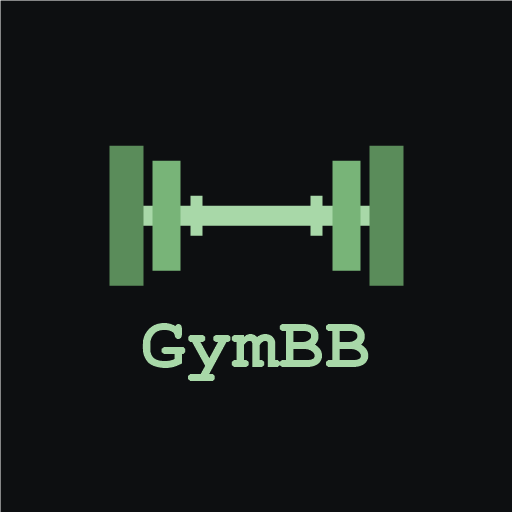

# GymBB

A minimal, offline workout tracker built specifically for the **BlackBerry Q5** (BlackBerry 10 OS 10.3.3.3216 / Android Runtime API 14+).

Designed with a sleek **terminal monospace aesthetic** matching [WhatsBB](https://github.com/warumpas-ops/whatsbb), tailored for the 720×720 square screen and physical QWERTY keyboard.



---

## Features

- **100% Offline & Private**: Zero cloud dependencies, zero analytics, zero network permissions. All your workout plans, logs, and statistics live in a local SQLite database on your device.
- **Terminal Monospace Aesthetic**: Pure `#0D0F11` dark background, `#E0E2E6` crisp text, `#A8D8A8` muted terminal green accents, monospace font across all screens.
- **Physical Keyboard Shortcuts (Q5 / Q10 / Classic / Passport)**:
  - `P` — Open Workout Plans
  - `E` — Open Exercise Library
  - `H` — Open History Log
  - `N` — Create New Plan / Exercise
- **Exercise Library**:
  - Pre-seeded with common compound and isolation exercises across chest, back, shoulders, legs, arms, and core.
  - Add custom exercises with target muscle groups and form notes.
- **Plan Builder & Day Scheduling**:
  - Group workouts into named routines (e.g. *Push Day*, *Pull Day*, *Legs*, *Upper/Lower*).
  - Assign to specific days of the week (`Mon` `Tue` `Wed` `Thu` `Fri` `Sat` `Sun`).
  - Configure target sets, reps, weight (kg or bodyweight), and rest interval (seconds) per exercise.
- **Smart Home Screen**:
  - Automatically recognizes today's day of the week.
  - Highlights today's scheduled workout with a 1-tap `[start workout]` action, or indicates a `-- rest day --`.
- **Live Active Workout Mode**:
  - Step-by-step set progression with live workout elapsed timer (`MM:SS`).
  - Shows current exercise, set counter (`set 2 / 4`), target reps, and target weight.
  - Integrated countdown rest timer between sets (`[✓ done]` triggers rest period).
  - Ability to skip sets or quit with confirmation.
  - Summary screen upon completion showing duration, exercises completed, and total sets logged.
- **Workout History**:
  - Comprehensive chronological log of completed sessions.
  - Displays date, total workout duration, plan name, exercise count, and set count.

---

## Compatibility

- **Target Device**: BlackBerry Q5 (BB10 10.3.3.3216)
- **Also works on**: BlackBerry Q10, BlackBerry Classic (Q20), BlackBerry Passport, and any Android device running Android 4.0+ (API 14+).
- **Target SDK**: 18 (Android 4.3 Jelly Bean — optimal compatibility for BB10 Android Runtime).

---

## Installation on BlackBerry 10

1. Download `GymBB.apk` from the [Releases](https://github.com/warumpas-ops/gymbb/releases) page.
2. Transfer the `.apk` file to your BlackBerry Q5 (via USB, micro-SD card, or browser).
3. In BlackBerry 10 **File Manager**, tap the `GymBB.apk` file and tap **Install**.
4. Launch GymBB from your home screen.

---

## Building from Source

Requirements:
- Android SDK (build-tools 34.0.0, compileSdk 34)
- JDK 17
- Gradle wrapper (included)

```bash
git clone https://github.com/warumpas-ops/gymbb.git
cd gymbb
./gradlew assembleDebug
```
The output APK will be at `app/build/outputs/apk/debug/app-debug.apk`.
